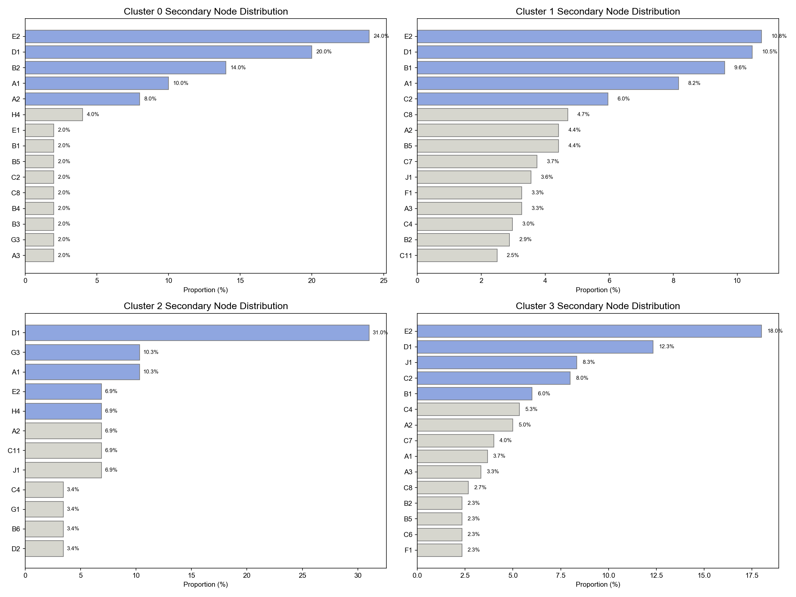
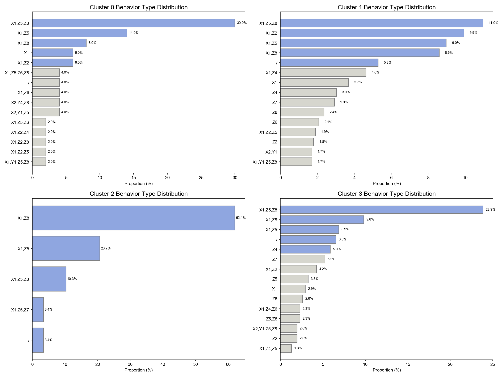

# 现有图表审查与公开待核实

四图均为工程现有PNG，未重新生成或改动统计值。图表为上海材料中的聚合统计，作者已确认四张图均由本人完成，本次保留为上海案例图表。

| 文件 | 核对结果 | 阅读说明 |
| --- | --- | --- |
| secondary-nodes.png | 图中各Cluster前5项百分比与现有汇总一致，例如Cluster0的E2=24%、D1=20%、B2=14%；Cluster2的D1约31% | 二级节点代码见taxonomy；展示前15项，不是完整节点分布 |
| secondary-nodes-by-category.png | 与上图同一指标，按一级类别着色 | 作为替代视图，不能当作独立证据 |
| behavior-combinations.png | 图中为组合代码，如X1,Z5,Z8；Cluster2的X1,Z8约62.1% | 英文标题Behavior Type容易让人理解为单一行为，应读作“行为组合分布”；“/”也在分母中 |
| primary-nodes.png | 由前15个二级节点合并并重新归一化 | 标题Primary Node Distribution缺少截断口径说明，不能当作全量一级构成 |

原配色脚本000.py对Cluster2的E2/H4设为蓝色，对C11/J1设为灰色，其余按Top5分配；因此蓝色不严格等于Top5，没有证据说明是统计显著项。论文中H4被写为residential areas，但代码H4是住宅，H3才是住宅区，需统一术语。

没有重新绘图来暗中“修正”分母，也不将这些图作为设计效果或统计显著性的证据。
